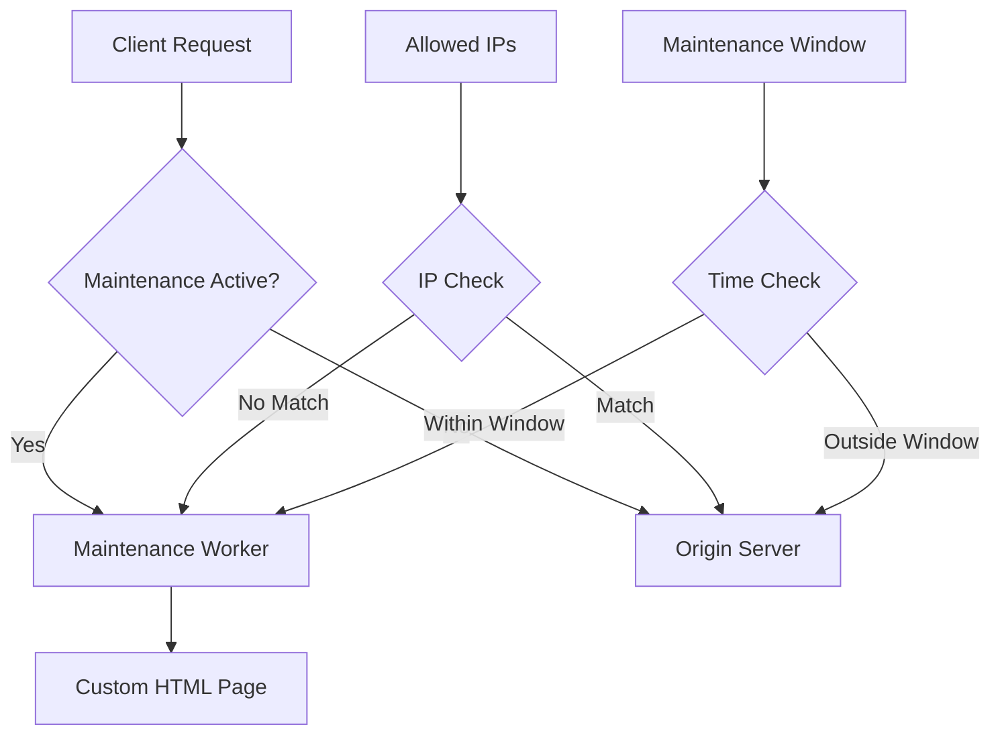

# Terraform Cloudflare Maintenance

[](https://sonarcloud.io/summary/new_code?id=somethingwithproof_terraform-cloudflare-maintenance)
[](https://github.com/somethingwithproof/terraform-cloudflare-maintenance/releases)
[](LICENSE)
[](https://github.com/RichardLitt/standard-readme)
[](versions.tf)
[](versions.tf)
[](tests/)
[](https://scorecard.dev/viewer/?uri=github.com/somethingwithproof/terraform-cloudflare-maintenance)

Enterprise-grade maintenance mode solution for Cloudflare infrastructure with OpenTofu.

> **Note**: This module has been migrated from Terraform to [OpenTofu](https://opentofu.org/), the open-source fork of Terraform. OpenTofu is a drop-in replacement and is fully compatible with existing Terraform configurations.

## Table of Contents

- [Overview](#overview)
- [Features](#features)
- [Security](#security)
- [Requirements](#requirements)
- [Installation](#installation)
- [Usage](#usage)
  - [Basic Usage](#basic-usage)
  - [Advanced Configuration](#advanced-configuration)
- [Architecture](#architecture)
- [Input Variables](#input-variables)
- [Outputs](#outputs)
- [Deploying with HCP Terraform](#deploying-with-hcp-terraform)
- [Upgrading from Cloudflare Provider v4 State](#upgrading-from-cloudflare-provider-v4-state)
- [Scheduled Maintenance Windows](#scheduled-maintenance-windows)
- [Bypass, Rate Limiting and Zone Rulesets](#bypass-rate-limiting-and-zone-rulesets)
- [Testing](#testing)
- [Contributing](#contributing)
- [License](#license)

## Overview

This Terraform module provides a robust, enterprise-ready maintenance mode solution for Cloudflare-hosted applications. It deploys a customizable maintenance page using Cloudflare Workers, with features like IP allowlisting, scheduled maintenance windows, and detailed analytics.

## Features

- 🛡️ **Customizable Maintenance Page**: Fully customizable HTML/CSS with support for logos and branding
- 🔒 **IP Allowlisting**: Allow IPv4/IPv6 addresses or CIDR ranges to bypass maintenance mode (e.g., for testing or monitoring). The Worker matches the `CF-Connecting-IP` header set by Cloudflare and never trusts `X-Forwarded-For`
- ⏱️ **Scheduled Maintenance Windows**: Set an RFC3339 window; the Worker serves the page only inside it, with no apply needed when it starts or ends
- 📊 **Analytics Integration**: Built-in logging and monitoring with Cloudflare Analytics Engine
- 🌍 **Region Bypass**: Let clients from listed countries past the maintenance page
- 🔄 **Zero-Downtime Toggle**: Enable/disable maintenance mode without redeployment
- 🔍 **SEO Friendly**: Proper HTTP status codes and headers for search engines
- 🔔 **Notification Support**: Slack, PagerDuty, and webhook integrations for maintenance alerts
- 🏷️ **Environment-Aware**: Support for multiple environments (production, staging, development)

## Security

### Compliance Features

- **GDPR Compliance**: All access logs are anonymized through Cloudflare's privacy features
- **Audit trail**: CD applies through GitHub Actions with state and run history in HCP Terraform
- **Secret Management**: API tokens stored as sensitive variables

### Access Controls

The module has no provider block or token variable. Configure the Cloudflare
provider in the calling root module, ideally from the `CLOUDFLARE_API_TOKEN`
environment variable so the token never appears in configuration or state:

```hcl
provider "cloudflare" {} # reads CLOUDFLARE_API_TOKEN
```

## Prerequisites

- OpenTofu >= 1.6.0 (or Terraform >= 1.5.0)
- Cloudflare Provider >= 5.19, < 6.0
- Cloudflare Account with Workers enabled
- Valid Cloudflare API credentials
- Cloudflare API Token with appropriate permissions:
  - Account.Workers Scripts:Edit
  - Zone.Workers Routes:Edit
  - Permission to edit the zone's rate limiting rules (only if `rate_limit.enabled` is true)

## Quick Start

Call the module from your own root configuration (see [Usage](#usage)), then:

```bash
export CLOUDFLARE_API_TOKEN=...   # or configure the provider another way
tofu init
tofu plan
tofu apply
```

## Module Structure

- `main.tf` - Primary Cloudflare Worker and route definitions
- `variables.tf` - Input variable declarations with validation
- `outputs.tf` - Output value definitions
- `versions.tf` - Provider version constraints
- `deploy/` - Root configuration the CD workflow applies with HCP Terraform state
- `modules/notifications/` - Notification integration submodule
- `examples/` - Usage examples (basic, advanced, scheduled)
- `tests/` - Integration tests


## Usage

### Basic Usage

```hcl
provider "cloudflare" {} # reads CLOUDFLARE_API_TOKEN

module "maintenance" {
  source = "github.com/somethingwithproof/terraform-cloudflare-maintenance"
  
  cloudflare_account_id = var.cloudflare_account_id
  cloudflare_zone_id = var.cloudflare_zone_id
  
  enabled = true
  maintenance_title = "System Upgrade in Progress"
  contact_email = "support@example.com"
  worker_route = "*.example.com/*"
  
  allowed_ips = [
    "192.168.1.1",
    "10.0.0.1"
  ]
}
```

### Advanced Configuration

For more advanced usage with scheduled maintenance windows, custom styling, and monitoring integration, see the [advanced example](examples/advanced-config/).

```hcl
module "maintenance" {
  source = "github.com/somethingwithproof/terraform-cloudflare-maintenance"
  
  cloudflare_account_id = var.cloudflare_account_id
  cloudflare_zone_id = var.cloudflare_zone_id
  
  # Environment configuration
  environment = "production"
  
  # Enable maintenance mode only for specific paths
  worker_route = "example.com/api/*"
  
  # Toggle maintenance mode based on environment
  enabled = var.environment == "production" ? false : true
  
  # Custom maintenance page content
  maintenance_title = "Scheduled System Maintenance"
  contact_email = "support@example.com"
  
  # Allow internal IPs to bypass maintenance
  allowed_ips = var.office_ip_ranges
  
  # Allow specific regions to bypass maintenance
  allowed_regions = ["US", "CA"]
  
  # Schedule maintenance window
  maintenance_window = {
    start_time = "2025-04-06T08:00:00Z"
    end_time = "2025-04-06T10:00:00Z"
  }
  
  # Custom styling
  custom_css = file("${path.module}/custom-styles.css")
  logo_url = "https://example.com/logo.png"
}
```

### Scheduled Maintenance with Notifications

See the [scheduled maintenance example](examples/scheduled-maintenance/) for a complete example with notification support.

```hcl
module "maintenance" {
  source = "github.com/somethingwithproof/terraform-cloudflare-maintenance"
  
  cloudflare_account_id = var.cloudflare_account_id
  cloudflare_zone_id    = var.cloudflare_zone_id
  
  environment = "production"
  enabled     = true
  
  # Time-based maintenance window
  maintenance_window = {
    start_time = "2025-04-06T08:00:00Z"
    end_time   = "2025-04-06T10:00:00Z"
  }
  
  # Custom branding
  custom_css = "body { background: linear-gradient(135deg, #667eea 0%, #764ba2 100%); }"
  logo_url   = "https://example.com/logo.png"
}

# Optional: Configure notifications
module "maintenance_notifications" {
  source = "github.com/somethingwithproof/terraform-cloudflare-maintenance//modules/notifications"

  # Keys are non-secret names; the URLs are secrets.
  notification_urls = {
    ops_slack = var.slack_webhook_url     # slack://T000/B000/XXXX
    oncall    = var.pagerduty_routing_key # pagerduty://<routing key>
  }

  maintenance_status = module.maintenance.maintenance_status
  schedule_name      = "scheduled-maintenance"
  environment        = "production"
  maintenance_window = module.maintenance.maintenance_window
}
```

## Architecture

The module deploys the following components:




## Input Variables

| Name | Description | Type | Default | Required |
|------|-------------|------|---------|:--------:|
| cloudflare_account_id | Cloudflare account ID | `string` | n/a | yes |
| cloudflare_zone_id | Cloudflare zone ID for the domain | `string` | n/a | yes |
| worker_route | URL pattern to trigger the maintenance worker | `string` | `"*.example.com/*"` | no |
| enabled | Serve the maintenance page until disabled; ignored while `maintenance_window` is set | `bool` | `false` | no |
| environment | Environment name (e.g., production, staging) | `string` | `"production"` | no |
| script_name | Worker script name, unique per account; defaults to `maintenance-page-<environment>` | `string` | `null` | no |
| maintenance_title | Title for the maintenance page | `string` | `"System Maintenance in Progress"` | no |
| maintenance_message | Message to display on the maintenance page | `string` | `"We are currently performing..."` | no |
| contact_email | Contact email to display on the maintenance page | `string` | `""` | no |
| allowed_ips | IPv4/IPv6 addresses or CIDR ranges that bypass the maintenance page; no leading zeros in IPv4 octets, and IPv4-mapped IPv6 ranges need a prefix of at least 96 | `list(string)` | `[]` | no |
| allowed_regions | List of ISO 3166-1 alpha-2 country codes that can bypass maintenance | `list(string)` | `[]` | no |
| maintenance_window | Window in RFC3339; deploys the route and serves the page only from `start_time` (inclusive) to `end_time` (exclusive) | `object({start_time=string, end_time=string})` | `null` | no |
| custom_css | Custom CSS for the maintenance page | `string` | `""` | no |
| logo_url | URL to the logo to display on the maintenance page | `string` | `""` | no |

For a complete list of variables, see [variables.tf](variables.tf).

## Outputs

| Name | Description |
|------|-------------|
| worker_id | The ID of the deployed worker script |
| worker_name | The name of the deployed worker script |
| worker_script_name | The name of the deployed worker script (alias) |
| worker_route_pattern | Cloudflare route pattern for the maintenance page |
| maintenance_status | SCHEDULED when a window is set, otherwise ENABLED or DISABLED |
| maintenance_enabled | Whether maintenance mode is currently enabled |
| environment | Environment name |
| maintenance_window | Scheduled maintenance window if configured |
| allowed_regions | List of allowed regions that can bypass maintenance |

For a complete list of outputs, see [outputs.tf](outputs.tf).

## Deploying with HCP Terraform

The module itself has no backend so it can be reused anywhere. `deploy/` is
the root configuration that `.github/workflows/cd.yml` applies, with state in
HCP Terraform through an empty `cloud {}` block configured from the
environment. The workflow runs on a `v*.*.*` tag (deploys `dev` with
maintenance off) or from **Run workflow**, where you pick the environment,
`enabled`, and an optional window. It checks its settings before `tofu init`
and fails if any is missing, so it never applies with local state.

Before the first run, set up:

| Where | Name | Value |
|-------|------|-------|
| Repository variable | `TF_CLOUD_ORGANIZATION` | HCP Terraform organization name |
| Repository secret | `TF_API_TOKEN` | HCP Terraform team or user API token with access to the workspaces |
| HCP Terraform workspaces | `cloudflare-maintenance-dev`, `cloudflare-maintenance-staging`, `cloudflare-maintenance-production` | CLI-driven workspaces with **Execution Mode: Local**, so runs happen in GitHub Actions and HCP stores state |
| GitHub environments `dev`, `staging`, `production` (secrets) | `CF_API_TOKEN`, `CF_ACCOUNT_ID`, `CF_ZONE_ID` | Cloudflare token with the permissions above, account and zone IDs |
| GitHub environments (variable) | `WORKER_ROUTE` | Route pattern, for example `example.com/*` |

Each environment deploys its own Worker, `maintenance-page-<environment>`, so
the three workspaces can share one Cloudflare account without overwriting or
deleting each other's Worker.

Use GitHub environment protection rules (for example required reviewers on
`production`) to gate applies. OpenTofu's `cloud` block speaks the HCP
Terraform API; HCP officially supports only Terraform, so check that state
upload works in the `dev` workspace first.

To use the same root locally:

```bash
export TF_CLOUD_ORGANIZATION=<org> TF_WORKSPACE=cloudflare-maintenance-dev
tofu login   # or export TF_TOKEN_app_terraform_io
cd deploy && tofu init && tofu plan
```

## Upgrading from Cloudflare Provider v4 State

The module uses the Cloudflare provider v5 schema. Follow Cloudflare's
[version 5 migration guide](https://github.com/cloudflare/terraform-provider-cloudflare/blob/main/docs/guides/version-5-migration.md)
for the prerequisites:

1. Back up the state first: `tofu state pull > terraform.tfstate.backup`.
2. If the state was written by a v4 provider older than v4.52.5, apply once
   with v4.52.5 before moving to v5.
3. Use provider v5.19 or later for the migration. Earlier v5 releases lack the
   automatic v4 state upgraders that `cloudflare_workers_script`,
   `cloudflare_workers_route` and `cloudflare_ruleset` rely on; those resources
   keep their types and are upgraded during the next plan.

The module no longer manages a status-page DNS record. State written by a
v4-era release still holds it as `cloudflare_record`, a type the v5 provider
does not know, so remove it from state before the first v5 plan. Replace
`module.maintenance` with your module address, then delete the
`maintenance-status-<environment>` record in the dashboard if you no longer
need it:

```bash
tofu state rm 'module.maintenance.cloudflare_record.maintenance_status[0]'
```

Review the next `tofu plan` before applying it.

## Bypass, Rate Limiting and Zone Rulesets

`allowed_ips` and `allowed_regions` only let matching clients past the
maintenance page; the Worker checks them itself. They do not skip the WAF,
managed rules or rate limiting, and the module creates no firewall rules for
them.

`rate_limit` is the one setting that touches zone rulesets. Enabling it creates
the zone's `http_ratelimit` entry-point ruleset, which a zone can have only one
of. Applying it fails on a zone that already has rate limiting rules, and
setting `rate_limit.enabled = false` deletes the entry-point ruleset along with
any rules added to it outside this module. Enable it only on zones whose rate
limiting rules are managed nowhere else. The rule matches every request
(`expression = "true"`), so it works on any plan that supports rate limiting
rules.

## Scheduled Maintenance Windows

| `enabled` | `maintenance_window` | Worker route | Maintenance page served |
|-----------|----------------------|--------------|-------------------------|
| `false` | unset | not deployed | never |
| `true` | unset | deployed | always, until `enabled` is set back to `false` |
| any | set | deployed | only from `start_time` (inclusive) to `end_time` (exclusive) |

The Worker reads the window from its `MAINTENANCE_WINDOW_START` and
`MAINTENANCE_WINDOW_END` bindings and checks the time on each request, so no
apply is needed when the window opens or closes. After it closes, unset
`maintenance_window` and apply to remove the route. `end_time` must be after
`start_time`. The module schedules one window at a time; for recurring
maintenance, have a scheduler set the next window and apply.

## Notification Integrations

The `modules/notifications` submodule announces maintenance to Slack,
PagerDuty (trigger, then resolve when maintenance ends) or any HTTPS webhook
when an apply changes the status or window. `notification_urls` is a sensitive
map of non-secret names to URLs; the URLs never reach plans, state or command
lines. See the [notifications module documentation](modules/notifications/README.md)
for URL formats and requirements.

## Development

Format code:
```bash
terraform fmt -recursive
```

Validate configuration:
```bash
terraform validate
```

Run linting:
```bash
tflint
```

## Testing

None of the automated tests call the Cloudflare API:

- **OpenTofu tests** (`tests/*.tftest.hcl`): plan the module against a mocked
  Cloudflare provider and assert on the planned resources, bindings and input
  validation.
- **Worker unit tests** (`tests/unit/`): run the shipped `worker.js` in a VM
  context and assert on its functions and responses.
- **Worker integration tests** (`tests/integration/`): run `worker.js` in
  Miniflare.
- **Examples**: CI runs `tofu validate` on every directory under `examples/`.

The Terratest suite in `tests/e2e/` applies the module to a real zone and only
runs from a manual `workflow_dispatch` with the `CF_E2E_*` settings for a
dedicated test zone. Every test copies the module to its own temporary
directory and deploys a uniquely named Worker on a unique hostname, so the
tests run in parallel without sharing state. The rate limiting test runs only
when `CF_E2E_RATE_LIMIT_ZONE_ID` names a throwaway zone, because it deletes
that zone's rate limiting rules.

```bash
tofu init -backend=false && tofu test   # OpenTofu tests
cd tests && npm ci && npm test          # Worker unit and integration tests
cd tests && npm run lint                # ESLint for worker.js and tests
```

## Contributing

Contributions are welcome! See [CONTRIBUTING.md](CONTRIBUTING.md) for guidelines.

1. Fork the repository
2. Create a feature branch (`git checkout -b feat/amazing-feature`)
3. Commit changes using Conventional Commits with emojis
4. Push to the branch (`git push origin feat/amazing-feature`)
5. Open a Pull Request

## License

[MIT © Thomas Vincent](LICENSE)
