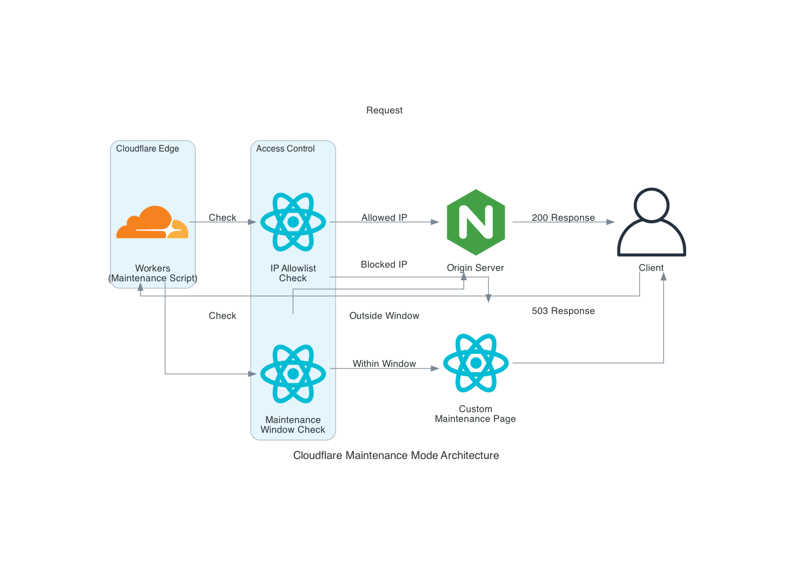
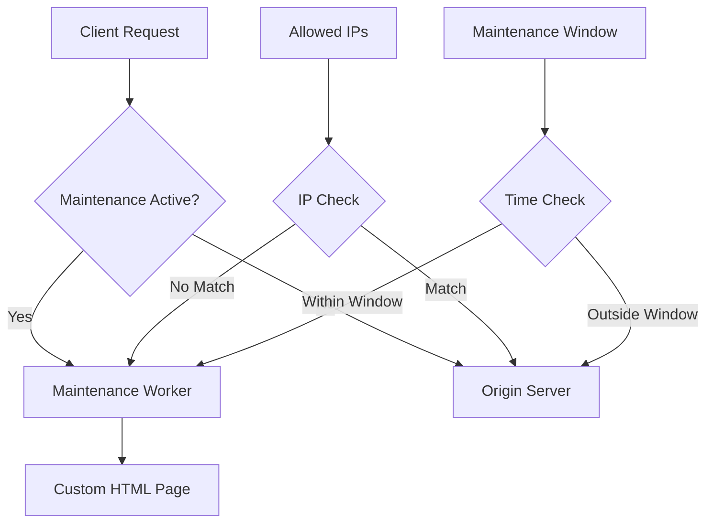

# Terraform Cloudflare Maintenance

[](https://sonarcloud.io/summary/new_code?id=somethingwithproof_terraform-cloudflare-maintenance)
[](https://github.com/somethingwithproof/terraform-cloudflare-maintenance/releases)
[](LICENSE)
[](https://github.com/RichardLitt/standard-readme)
[](versions.tf)
[](versions.tf)
[](tests/)
[](https://scorecard.dev/viewer/?uri=github.com/somethingwithproof/terraform-cloudflare-maintenance)

Enterprise-grade maintenance mode solution for Cloudflare infrastructure with OpenTofu.

> **Note**: This module has been migrated from Terraform to [OpenTofu](https://opentofu.org/), the open-source fork of Terraform. OpenTofu is a drop-in replacement and is fully compatible with existing Terraform configurations.

## Table of Contents

- [Overview](#overview)
- [Features](#features)
- [Security](#security)
- [Requirements](#requirements)
- [Installation](#installation)
- [Usage](#usage)
  - [Basic Usage](#basic-usage)
  - [Advanced Configuration](#advanced-configuration)
- [Architecture](#architecture)
- [Input Variables](#input-variables)
- [Outputs](#outputs)
- [Deploying with HCP Terraform](#deploying-with-hcp-terraform)
- [Upgrading from Cloudflare Provider v4 State](#upgrading-from-cloudflare-provider-v4-state)
- [Scheduled Maintenance Windows](#scheduled-maintenance-windows)
- [Bypass, Rate Limiting and Zone Rulesets](#bypass-rate-limiting-and-zone-rulesets)
- [Testing](#testing)
- [Contributing](#contributing)
- [License](#license)

## Overview

This Terraform module provides a robust, enterprise-ready maintenance mode solution for Cloudflare-hosted applications. It deploys a customizable maintenance page using Cloudflare Workers, with features like IP allowlisting, scheduled maintenance windows, and detailed analytics.

## Features

- 🛡️ **Customizable Maintenance Page**: Fully customizable HTML/CSS with support for logos and branding
- 🔒 **IP Allowlisting**: Allow IPv4/IPv6 addresses or CIDR ranges to bypass maintenance mode (e.g., for testing or monitoring). The Worker matches the `CF-Connecting-IP` header set by Cloudflare and never trusts `X-Forwarded-For`
- ⏱️ **Scheduled Maintenance Windows**: Set an RFC3339 window; the Worker serves the page only inside it, with no apply needed when it starts or ends
- 📊 **Analytics Integration**: Built-in logging and monitoring with Cloudflare Analytics Engine
- 🌍 **Region Bypass**: Let clients from listed countries past the maintenance page
- 🔄 **Zero-Downtime Toggle**: Enable/disable maintenance mode without redeployment
- 🔍 **SEO Friendly**: Proper HTTP status codes and headers for search engines
- 🔔 **Notification Support**: Slack, PagerDuty, and webhook integrations for maintenance alerts
- 🏷️ **Environment-Aware**: Support for multiple environments (production, staging, development)

## Security

### Compliance Features

- **GDPR Compliance**: All access logs are anonymized through Cloudflare's privacy features
- **Audit trail**: CD applies through GitHub Actions with state and run history in HCP Terraform
- **Secret Management**: API tokens stored as sensitive variables

### Access Controls

The module has no provider block or token variable. Configure the Cloudflare
provider in the calling root module, ideally from the `CLOUDFLARE_API_TOKEN`
environment variable so the token never appears in configuration or state:

```hcl
provider "cloudflare" {} # reads CLOUDFLARE_API_TOKEN
```

## Prerequisites

- OpenTofu >= 1.6.0 (or Terraform >= 1.5.0)
- Cloudflare Provider >= 5.19, < 6.0
- Cloudflare Account with Workers enabled
- Valid Cloudflare API credentials
- Cloudflare API Token with appropriate permissions:
  - Account.Workers Scripts:Edit
  - Zone.Workers Routes:Edit
  - Permission to edit the zone's rate limiting rules (only if `rate_limit.enabled` is true)
  - Account.Workers KV Storage:Edit (only if `runtime_toggle.enabled` is true)

## Quick Start

Call the module from your own root configuration (see [Usage](#usage)), then:

```bash
export CLOUDFLARE_API_TOKEN=...   # or configure the provider another way
tofu init
tofu plan
tofu apply
```

## Module Structure

- `main.tf` - Primary Cloudflare Worker and route definitions
- `variables.tf` - Input variable declarations with validation
- `outputs.tf` - Output value definitions
- `versions.tf` - Provider version constraints
- `deploy/` - Root configuration the CD workflow applies with HCP Terraform state
- `modules/notifications/` - Notification integration submodule
- `worker/` - The Worker in TypeScript (`src/`), its tests (`test/`) and the
  committed bundle Terraform deploys (`dist/index.js`)
- `examples/` - Usage examples (basic, advanced, scheduled)
- `tests/` - OpenTofu tests, shared fixtures and the Terratest suite (`e2e/`)


## Usage

### Basic Usage

```hcl
provider "cloudflare" {} # reads CLOUDFLARE_API_TOKEN

module "maintenance" {
  source = "github.com/somethingwithproof/terraform-cloudflare-maintenance"
  
  cloudflare_account_id = var.cloudflare_account_id
  cloudflare_zone_id = var.cloudflare_zone_id
  
  enabled = true
  maintenance_title = "System Upgrade in Progress"
  contact_email = "support@example.com"
  worker_route = "*.example.com/*"
  
  allowed_ips = [
    "192.168.1.1",
    "10.0.0.1"
  ]
}
```

### Advanced Configuration

For more advanced usage with scheduled maintenance windows, custom styling, and monitoring integration, see the [advanced example](examples/advanced-config/).

```hcl
module "maintenance" {
  source = "github.com/somethingwithproof/terraform-cloudflare-maintenance"
  
  cloudflare_account_id = var.cloudflare_account_id
  cloudflare_zone_id = var.cloudflare_zone_id
  
  # Environment configuration
  environment = "production"
  
  # Enable maintenance mode only for specific paths
  worker_route = "example.com/api/*"
  
  # Toggle maintenance mode based on environment
  enabled = var.environment == "production" ? false : true
  
  # Custom maintenance page content
  maintenance_title = "Scheduled System Maintenance"
  contact_email = "support@example.com"
  
  # Allow internal IPs to bypass maintenance
  allowed_ips = var.office_ip_ranges
  
  # Allow specific regions to bypass maintenance
  allowed_regions = ["US", "CA"]
  
  # Schedule maintenance window
  maintenance_window = {
    start_time = "2025-04-06T08:00:00Z"
    end_time = "2025-04-06T10:00:00Z"
  }
  
  # Custom styling
  custom_css = file("${path.module}/custom-styles.css")
  logo_url = "https://example.com/logo.png"
}
```

### Scheduled Maintenance with Notifications

See the [scheduled maintenance example](examples/scheduled-maintenance/) for a complete example with notification support.

```hcl
module "maintenance" {
  source = "github.com/somethingwithproof/terraform-cloudflare-maintenance"
  
  cloudflare_account_id = var.cloudflare_account_id
  cloudflare_zone_id    = var.cloudflare_zone_id
  
  environment = "production"
  enabled     = true
  
  # Time-based maintenance window
  maintenance_window = {
    start_time = "2025-04-06T08:00:00Z"
    end_time   = "2025-04-06T10:00:00Z"
  }
  
  # Custom branding
  custom_css = "body { background: linear-gradient(135deg, #667eea 0%, #764ba2 100%); }"
  logo_url   = "https://example.com/logo.png"
}

# Optional: Configure notifications
module "maintenance_notifications" {
  source = "github.com/somethingwithproof/terraform-cloudflare-maintenance//modules/notifications"

  # Keys are non-secret names; the URLs are secrets.
  notification_urls = {
    ops_slack = var.slack_webhook_url     # slack://T000/B000/XXXX
    oncall    = var.pagerduty_routing_key # pagerduty://<routing key>
  }

  maintenance_status = module.maintenance.maintenance_status
  schedule_name      = "scheduled-maintenance"
  environment        = "production"
  maintenance_window = module.maintenance.maintenance_window
}
```

## Architecture

The module deploys the following components:





## Input Variables

| Name | Description | Type | Default | Required |
|------|-------------|------|---------|:--------:|
| cloudflare_account_id | Cloudflare account ID | `string` | n/a | yes |
| cloudflare_zone_id | Cloudflare zone ID for the domain | `string` | n/a | yes |
| worker_route | URL pattern to trigger the maintenance worker | `string` | `"*.example.com/*"` | no |
| enabled | Serve the maintenance page until disabled; ignored while `maintenance_window` is set | `bool` | `false` | no |
| environment | Environment name (e.g., production, staging) | `string` | `"production"` | no |
| script_name | Worker script name, unique per account; defaults to `maintenance-page-<environment>` | `string` | `null` | no |
| maintenance_title | Title for the maintenance page | `string` | `"System Maintenance in Progress"` | no |
| maintenance_message | Message to display on the maintenance page | `string` | `"We are currently performing..."` | no |
| contact_email | Contact email to display on the maintenance page | `string` | `""` | no |
| allowed_ips | IPv4/IPv6 addresses or CIDR ranges that bypass the maintenance page; no leading zeros in IPv4 octets, and IPv4-mapped IPv6 ranges need a prefix of at least 96 | `list(string)` | `[]` | no |
| allowed_regions | List of ISO 3166-1 alpha-2 country codes that can bypass maintenance | `list(string)` | `[]` | no |
| maintenance_window | Window in RFC3339; deploys the route and serves the page only from `start_time` (inclusive) to `end_time` (exclusive) | `object({start_time=string, end_time=string})` | `null` | no |
| custom_css | Custom CSS for the maintenance page | `string` | `""` | no |
| logo_url | URL to the logo to display on the maintenance page | `string` | `""` | no |
| retry_after_seconds | `Retry-After` outside a window; inside one it is the time left | `number` | `3600` | no |
| status_path | Path of the JSON status endpoint; `""` disables it | `string` | `"/__maintenance/status"` | no |
| pages | Title and message overrides per hostname and path prefix | `list(object({host, path_prefix, title, message}))` | `[]` | no |
| runtime_toggle | Switch maintenance at runtime through Workers KV; see [Runtime Toggle](#runtime-toggle) | `object({enabled, failure_mode, cache_ttl_seconds})` | `{enabled=false, failure_mode="open", cache_ttl_seconds=60}` | no |

For a complete list of variables, see [variables.tf](variables.tf).

## Outputs

| Name | Description |
|------|-------------|
| worker_id | The ID of the deployed worker script |
| worker_name | The name of the deployed worker script |
| worker_script_name | The name of the deployed worker script (alias) |
| worker_route_pattern | Cloudflare route pattern for the maintenance page |
| maintenance_status | SCHEDULED when a window is set, otherwise ENABLED or DISABLED |
| maintenance_enabled | Whether maintenance mode is currently enabled |
| environment | Environment name |
| maintenance_window | Scheduled maintenance window if configured |
| allowed_regions | List of allowed regions that can bypass maintenance |

For a complete list of outputs, see [outputs.tf](outputs.tf).

## Deploying with HCP Terraform

The module itself has no backend so it can be reused anywhere. `deploy/` is
the root configuration that `.github/workflows/cd.yml` applies, with state in
HCP Terraform through an empty `cloud {}` block configured from the
environment. The workflows run in Local execution mode, which ignores HCP
workspace variables, so every input comes from the GitHub environment. The
workflow checks its settings before `tofu init` and fails if any is missing
or malformed, so it never applies with local state or half its settings.

What a run deploys:

- A `v*.*.*` tag push deploys `dev` with exactly the `dev` environment's
  variables below. It never turns maintenance on or off by itself.
- **Run workflow** deploys the chosen environment with the same variables,
  and can override `enabled` and the window for that one run
  (`enabled: environment` keeps the variable). The next run without
  overrides goes back to the variables, so make lasting changes there.

Set up once:

| Where | Name | Value |
|-------|------|-------|
| Repository variable | `TF_CLOUD_ORGANIZATION` | HCP Terraform organization name |
| HCP Terraform workspaces | `cloudflare-maintenance-dev`, `cloudflare-maintenance-staging`, `cloudflare-maintenance-production` | CLI-driven workspaces with **Execution Mode: Local**, so runs happen in GitHub Actions and HCP stores state |
| GitHub environments `dev`, `staging`, `production` (secrets) | `TF_API_TOKEN` | HCP Terraform team token with access to that environment's workspace only, so a `dev` run cannot write `production` state |
| | `CF_API_TOKEN`, `CF_ACCOUNT_ID`, `CF_ZONE_ID` | Cloudflare token with the permissions above, account and zone IDs |
| GitHub environments (variables) | `WORKER_ROUTE` | Route pattern, for example `example.com/*` (required) |
| | `MAINTENANCE_ENABLED` | `true` or `false`; unset means `false` |
| | `MAINTENANCE_WINDOW` | JSON `{"start_time": "...", "end_time": "..."}` in RFC3339, or unset |
| | `ALLOWED_IPS`, `ALLOWED_REGIONS` | JSON arrays of strings, for example `["192.0.2.0/24"]` and `["US"]`; unset means none |
| | `CONTACT_EMAIL` | Address shown on the page; unset means none |
| | `RUNTIME_TOGGLE` | `true` to create the runtime toggle; unset means `false` |
| | `KV_NAMESPACE_ID` | For **Toggle maintenance**: the `runtime_toggle_namespace_id` output of the first deploy with `RUNTIME_TOGGLE=true` |
| GitHub environments (secrets, optional) | `MAINTENANCE_NOTIFY_URL` | Notification target for **Toggle maintenance**, in the notifications module's URL format |

Each environment deploys its own Worker, `maintenance-page-<environment>`, so
the three workspaces can share one Cloudflare account without overwriting or
deleting each other's Worker.

The environments only accept deployments from `main` and `v*` tags, and
`production` waits for a required reviewer. Tag creation for `v*` is limited
to repository administrators by a tag ruleset. OpenTofu's `cloud` block
speaks the HCP Terraform API; HCP officially supports only Terraform, so
check that state upload works in the `dev` workspace first.

`deploy/.terraform.lock.hcl` pins the provider builds for `linux_amd64`,
`darwin_arm64` and `darwin_amd64`, and CI and CD run `tofu init
-lockfile=readonly`, so an apply always uses the reviewed provider. Dependabot
(`opentofu` ecosystem) proposes updates; to update by hand, run
`tofu providers lock -platform=linux_amd64 -platform=darwin_arm64
-platform=darwin_amd64` in `deploy/` and commit the result.

To use the same root locally:

```bash
export TF_CLOUD_ORGANIZATION=<org> TF_WORKSPACE=cloudflare-maintenance-dev
tofu login   # or export TF_TOKEN_app_terraform_io
cd deploy && tofu init && tofu plan
```

## Upgrading from Cloudflare Provider v4 State

The module uses the Cloudflare provider v5 schema. Follow Cloudflare's
[version 5 migration guide](https://github.com/cloudflare/terraform-provider-cloudflare/blob/main/docs/guides/version-5-migration.md)
for the prerequisites:

1. Back up the state first: `tofu state pull > terraform.tfstate.backup`.
2. If the state was written by a v4 provider older than v4.52.5, apply once
   with v4.52.5 before moving to v5.
3. Use provider v5.19 or later for the migration. Earlier v5 releases lack the
   automatic v4 state upgraders that `cloudflare_workers_script`,
   `cloudflare_workers_route` and `cloudflare_ruleset` rely on; those resources
   keep their types and are upgraded during the next plan.

The module no longer manages a status-page DNS record. State written by a
v4-era release still holds it as `cloudflare_record`, a type the v5 provider
does not know, so remove it from state before the first v5 plan. Replace
`module.maintenance` with your module address, then delete the
`maintenance-status-<environment>` record in the dashboard if you no longer
need it:

```bash
tofu state rm 'module.maintenance.cloudflare_record.maintenance_status[0]'
```

Review the next `tofu plan` before applying it.

## Bypass, Rate Limiting and Zone Rulesets

`allowed_ips` and `allowed_regions` only let matching clients past the
maintenance page; the Worker checks them itself. They do not skip the WAF,
managed rules or rate limiting, and the module creates no firewall rules for
them.

`rate_limit` is the one setting that touches zone rulesets. Enabling it creates
the zone's `http_ratelimit` entry-point ruleset, which a zone can have only one
of. Applying it fails on a zone that already has rate limiting rules, and
setting `rate_limit.enabled = false` deletes the entry-point ruleset along with
any rules added to it outside this module. Enable it only on zones whose rate
limiting rules are managed nowhere else. The rule matches every request
(`expression = "true"`), so it works on any plan that supports rate limiting
rules.

## Scheduled Maintenance Windows

| `enabled` | `maintenance_window` | Worker route | Maintenance page served |
|-----------|----------------------|--------------|-------------------------|
| `false` | unset | not deployed | never |
| `true` | unset | deployed | always, until `enabled` is set back to `false` |
| any | set | deployed | only from `start_time` (inclusive) to `end_time` (exclusive) |

The Worker reads the window from its `MAINTENANCE_WINDOW_START` and
`MAINTENANCE_WINDOW_END` bindings and checks the time on each request, so no
apply is needed when the window opens or closes. After it closes, unset
`maintenance_window` and apply to remove the route. `end_time` must be after
`start_time`. The module schedules one window at a time; for recurring
maintenance, have a scheduler set the next window and apply.

## Runtime Toggle

An apply takes minutes and needs Terraform credentials. With
`runtime_toggle = { enabled = true }` the module also creates a Workers KV
namespace (output `runtime_toggle_namespace_id`) that the Worker reads on
each request, so maintenance can be switched in about a minute:

```bash
export CLOUDFLARE_API_TOKEN=...   # Workers KV Storage:Edit; read from your secret store
export CF_ACCOUNT_ID=... KV_NAMESPACE_ID=$(tofu output -raw runtime_toggle_namespace_id)
scripts/maintenance on --message "Database failover, back in 10 minutes"
scripts/maintenance schedule 2030-04-06T08:00:00Z 2030-04-06T10:00:00Z
scripts/maintenance off      # pass traffic through now, even inside a Terraform window
scripts/maintenance clear    # remove the override; Terraform's settings apply again
scripts/maintenance status
```

The **Toggle maintenance** workflow runs the same script for a GitHub
environment, with that environment's `CF_API_TOKEN`, `CF_ACCOUNT_ID` and
`KV_NAMESPACE_ID`.

- **Precedence.** The override is one KV value. Each field it sets
  (`enabled`, `window`, `title`, `message`) replaces the Terraform value, and
  a title or message set there replaces `pages` too. Terraform never writes
  the value, so an apply does not undo a toggle; `clear` does.
- **Propagation.** Each edge location caches the value for
  `cache_ttl_seconds` (default 60, minimum 30) and KV takes up to about a
  minute to propagate a write, so allow up to two minutes.
- **Failures.** If KV cannot be read or holds a malformed value,
  `failure_mode = "open"` (the default) passes traffic to the origin and
  `"closed"` serves the maintenance page. A missing value is not a failure:
  Terraform's settings apply.
- **Notifications.** With `NOTIFY_URL` (or the `MAINTENANCE_NOTIFY_URL`
  environment secret) set, `on` triggers, `off` and `clear` resolve and
  `schedule` informs Slack and webhooks without paging. The PagerDuty dedup
  key is `terraform-cloudflare-maintenance/<environment>/<NOTIFY_SCHEDULE>`
  (default schedule `runtime-toggle`); set `NOTIFY_SCHEDULE` to a schedule
  name of the notifications module to share its incident.
- **Cost and latency.** The route stays deployed while the toggle is
  enabled, so the Worker runs on every request to the route even when
  maintenance is off: every request counts toward Workers requests billing,
  adds the Worker's start-up time (typically a few milliseconds) and makes a
  KV read, served from the edge cache within `cache_ttl_seconds`. Without the
  toggle, the route exists only while `enabled` or a window is set.

## HTTP Responses

While maintenance is on, every routed request that does not bypass gets:

- `503 Service Unavailable` with `Content-Type: text/html; charset=utf-8`,
  `Cache-Control: no-store, no-cache, must-revalidate` and `Retry-After`.
  `HEAD` requests get the same status and headers without a body.
- A Content Security Policy that allows only inline styles and HTTPS images
  (`default-src 'none'`, `form-action 'none'`, `base-uri 'none'`,
  `frame-ancestors 'none'`), plus `X-Content-Type-Options: nosniff`,
  `X-Frame-Options: DENY` and `Referrer-Policy: no-referrer`.

`status_path` (default `/__maintenance/status`) answers `GET` and `HEAD` on
every routed hostname, for everyone and whether maintenance is on or off,
without contacting the origin:

```json
{"maintenance": true, "window": {"start_time": "2030-04-06T08:00:00.000Z", "end_time": "2030-04-06T10:00:00.000Z"}, "retry_after_seconds": 1800}
```

`window` is `null` without a scheduled window and `retry_after_seconds` is
`null` while maintenance is off. Other methods get `405`. The response is
`no-store` and allows any origin, so a status page can poll it; it holds no
allowlist entries or contact details. It is only reachable while the route
is deployed (see the table above). Set `status_path = ""` if the origin
already serves that path.

`pages` changes the title and message for particular hostnames or paths:

```hcl
pages = [
  { host = "api.example.com", message = "The API is read-only until 10:00 UTC." },
  { path_prefix = "/checkout", title = "Checkout is paused" },
]
```

The most specific entry wins: an entry with a matching `host` beats one
without, then the longest `path_prefix`. Prefixes match whole path segments
(`/api` covers `/api/v1`, not `/apis`). Fields an entry leaves out fall back to
`maintenance_title` and `maintenance_message`.

## Notification Integrations

The `modules/notifications` submodule announces maintenance to Slack,
PagerDuty (trigger, then resolve when maintenance ends) or any HTTPS webhook
when an apply changes the status or window, after the Cloudflare changes in
that apply have succeeded. A `SCHEDULED` window pages nobody, and because
nothing applies when a window opens or closes, the module cannot page at
those moments; see the module README. `notification_urls` is a sensitive
map of non-secret names to URLs; the URLs never reach plans, state or command
lines. See the [notifications module documentation](modules/notifications/README.md)
for URL formats and requirements.

## Development

```bash
tofu fmt -recursive
tofu validate
tflint
```

The Worker is TypeScript in `worker/src`. Terraform uploads
`worker/dist/index.js`, the bundle wrangler builds from it, which is
committed so that using the module needs no Node toolchain. After changing
`worker/src`, rebuild and commit the bundle; CI fails when it is stale:

```bash
cd worker
npm ci --ignore-scripts
npm run build       # writes dist/index.js
npm run dev         # serves the Worker locally with the vars in wrangler.json
```

`worker/wrangler.json` holds the runtime `compatibility_date`, which the
module deploys with as well, and the local defaults for every binding.

## Testing

None of the automated tests call the Cloudflare API:

- **OpenTofu tests** (`tests/*.tftest.hcl`): plan the module against a mocked
  Cloudflare provider and assert on the planned resources, bindings and input
  validation.
- **Worker tests** (`worker/test/worker/`): run the Worker in workerd, the
  Workers runtime, through the Cloudflare Vitest plugin. The unit tests call
  the request handler with their own bindings and clock; the integration
  tests send requests through the Worker's `fetch` export with the bindings
  in `wrangler.json`.
- **Notification script tests** (`worker/test/scripts/`): run
  `modules/notifications/notify.sh` with a stub `curl`.
- **Examples**: CI runs `tofu validate` on every directory under `examples/`.

The Terratest suite in `tests/e2e/` applies the module to a real zone. It
runs only from **E2E Tests > Run workflow** on `main`, in the `e2e` GitHub
environment, which holds the settings for a dedicated test zone: secrets
`CF_E2E_API_TOKEN` (Workers Scripts and Workers Routes edit on that zone's
account), `CF_E2E_ACCOUNT_ID`, `CF_E2E_ZONE_ID`, optional
`CF_E2E_RATE_LIMIT_ZONE_ID`, and the variable `CF_E2E_ZONE_NAME`. Without
them the run succeeds with a warning that nothing was tested. Every test copies the module to its own temporary
directory and deploys a uniquely named Worker on a unique hostname, so the
tests run in parallel without sharing state. The rate limiting test runs only
when `CF_E2E_RATE_LIMIT_ZONE_ID` names a throwaway zone, because it deletes
that zone's rate limiting rules.

```bash
tofu init -backend=false && tofu test   # OpenTofu tests
cd worker && npm ci --ignore-scripts
npm test                                # Worker and notify.sh tests
npm run typecheck && npm run lint       # tsc --noEmit and typescript-eslint
```

## Contributing

Contributions are welcome! See [CONTRIBUTING.md](CONTRIBUTING.md) for guidelines.

1. Fork the repository
2. Create a feature branch (`git checkout -b feat/amazing-feature`)
3. Commit changes using Conventional Commits with emojis
4. Push to the branch (`git push origin feat/amazing-feature`)
5. Open a Pull Request

## License

[MIT © Thomas Vincent](LICENSE)
